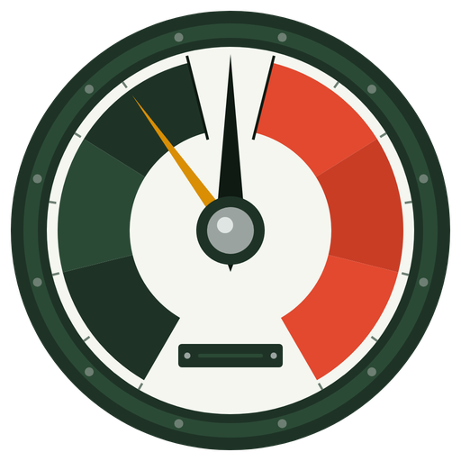
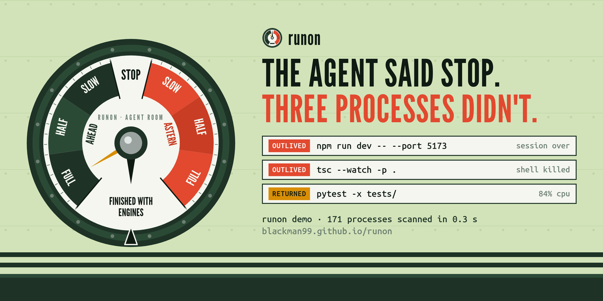

<p align="center"></p>

<h1 align="center">runon</h1>

<p align="center"><b>The agent said stop. Three processes didn't.</b><br>
Find the processes Claude Code, Codex and OpenCode started that are still running after the tool call, the stop, or the whole session ended. Stop exactly those, nothing else.</p>

<p align="center">
<a href="https://blackman99.github.io/runon/">Landing</a> ·
<a href="https://blackman99.github.io/runon/docs/">Docs</a> ·
<a href="https://github.com/Blackman99/runon/releases/latest">Releases</a> ·
<a href="https://github.com/Blackman99/runon/actions/workflows/ci.yml"></a>
</p>



## Read this in order

1. **[Why](#why)**: what leaks, with real reports.
2. **[Install](#install)**: one line, checksum-verified.
3. **[Try it with no agent](#demo)**: `runon demo` makes a real, small mess.
4. **[How it decides](#how-it-decides)**: the stamp, the parent chain, the verdicts.
5. **[Stop them](#stop)**, and the **[SessionEnd hook](#hook)** so it never piles up again.
6. **[What was tested, and what wasn't](#tested)**.

## Why

People keep reporting the same thing in different trackers: the agent says a command was stopped, or the session is over, but the process it started keeps going.

- [anthropics/claude-code#104388](https://github.com/anthropics/claude-code/issues/104388): a "read-only" watcher session; after TaskStop killed the shell, the orphaned `du.exe` kept walking the disk for about 70 minutes, and the site was down for 41.
- [anthropics/claude-code#104308](https://github.com/anthropics/claude-code/issues/104308): an orphaned `bun` process from the Telegram channel plugin can spin at about 67 % CPU for hours after the session disconnects.
- [anthropics/claude-code#104477](https://github.com/anthropics/claude-code/issues/104477): plugin LSP servers have no idle timeout, so idle servers pile up across sessions.
- [openai/codex#56335](https://github.com/openai/codex/issues/56335): on the Windows desktop app, every loaded thread starts a new set of stdio MCP servers that are never stopped.

`pkill node` is the usual fix, and it also kills the dev server you started yourself. runon only touches what an agent started.

## Install

```sh
curl -fsSL https://blackman99.github.io/runon/install.sh | sh
```

The script picks the binary for your OS and CPU, checks it against `checksums.txt`, and puts it in `~/.local/bin` (`RUNON_BIN=...` to change, `RUNON_VERSION=v0.1.0` to pin). Prebuilt for Linux (x86_64, arm64, static musl), macOS (arm64, x86_64) and Windows (x86_64, arm64, `.zip` on the [release page](https://github.com/Blackman99/runon/releases/latest)). From source, Rust 1.85+:

```sh
cargo install --git https://github.com/Blackman99/runon
```

## Demo

No agent handy? `runon demo` starts three throwaway fake sessions (copies of runon named `claude` and `codex`) that spawn real child processes, then lets go of some of them the way a harness does:

```text
$ runon demo
runon  3 still running after their agent let go
       scanned 171 processes in 0.3s · 6 started by agents · 2 harnesses running

 OUTLIVED  npm run dev -- --port 5173                                    DEMO  pid 2418516 +1
           claude 1c6bfc7e  session is over · log last written 1s ago
           Bash (background) toolu_01Demo8… 4s ago: npm run dev -- --port 5173
           up 2s · 0.0% cpu · 4.6 MB · /tmp/runon-demo-27762f71/shop

 OUTLIVED  tsc --watch -p .                                                 DEMO  pid 2418523
           claude 2b72434c  session still open (claude pid 2418517) but no longer holds this
           Bash (background) toolu_01Demo7… 4s ago: tsc --watch -p .

 RETURNED  pytest -x tests/                                             HOT DEMO  pid 2418518
           codex ba898a2a  tool call returned 3s ago · codex pid 2418515 still open
           exec_command call_demo_pyt… 4s ago: pytest -x tests/
           up 2s · 84.6% cpu · 2.2 MB · /tmp/runon-demo-27762f71/shop
```

`runon stop --demo` ends them; they also exit by themselves after ten minutes. Then run plain `runon` on your own machine.

## How it decides

Every harness stamps the environment of what it spawns, and the environment survives orphaning:

| Harness | Stamp read from the process environment |
|---|---|
| Codex | `CODEX_SESSION_ID`, `CODEX_THREAD_ID`, `CODEX_TOOL_CALL_ID` |
| Claude Code 2.1.x | `CLAUDECODE=1`, `CLAUDE_CODE_SESSION_ID` (+ `CLAUDE_PROJECT_DIR` for stdio MCP servers) |
| OpenCode | `OPENCODE=1`, `OPENCODE_PID` (1.19.x) or `OPENCODE_SESSION_ID` |

runon then walks each stamped process's parent chain, checking that each parent started before its child (Windows does not reparent, and PIDs get reused), to see whether a live harness still holds it:

- **OUTLIVED**: no live harness above it. The session ended, or the shell above it was killed by TaskStop or a timeout.
- **RETURNED** (Codex): the session is alive, but the rollout already has the output of the tool call that started it.
- **LIVE**: still attached. Shown with `--all`, never stopped by default.
- Tags: `HOT` ≥ 50 % of a core, `BIG` ≥ 500 MB RSS, `MCP` stdio MCP server.

It also links each tree to its transcript (Claude `~/.claude/projects/*/<session>.jsonl`, Codex `~/.codex/sessions/**/rollout-*.jsonl`), and for Claude Code to the Bash tool call whose command matches. No network, ever.

## Stop

```sh
runon stop --dry-run   # list what would be signalled
runon stop             # asks, then TERM → 3 s grace → KILL, per tree
```

By default only OUTLIVED trees. Widen with `--returned`, `--session ID`, `--pid N`. It never signals a harness process or its own parent chain, re-checks PID + start time right before every signal, and refuses to run without a terminal unless you pass `--yes`. Exit codes: `0` clean, `3` strays found, `1` error, `64` usage. `--json` everywhere.

### Hook

```sh
runon hook claude   # prints a SessionEnd hook for ~/.claude/settings.json
```

When a Claude Code session ends, `runon stop --hook` stops what that session left behind and nothing else.

## What was tested, and what wasn't <a id="tested"></a>

- CI runs the unit tests and an end-to-end test against **real processes** on Linux, macOS and Windows: `runon demo` spawns stamped children, runon has to find them with the right verdict and stop exactly those.
- The env stamps were read from the harnesses' source and shipped binaries (Codex `codex-rs/protocol/src/shell_environment.rs`, OpenCode `packages/core/src/tool/plugin/shell.ts`, strings in the Claude Code 2.1.x binary).
- **OpenCode 1.19.4 on Linux was checked in a real `opencode run` session** (2026-10-23): a backgrounded `sleep 600` carried `OPENCODE=1`, `AGENT=1`, `OPENCODE_PID=<harness pid>` and no `OPENCODE_SESSION_ID`; runon listed it as OUTLIVED linked to the live opencode pid. When the session exited, OpenCode had already ended the `sleep` itself, so nothing was left. That changed runon to read `OPENCODE_PID`.
- **Not yet tested inside a real Claude Code or Codex session, and not inside any real session on macOS or Windows.** The demo uses fake harnesses that set the same variables. If a verdict is wrong on your machine, `runon --all --json` output in an issue is the most useful bug report.
- Cursor, Aider and Gemini CLI are not covered until their stamps are verified.

## Articles

- [How coding agents mark the processes they start, and why they outlive the session](docs/blog/how-runon-finds-agent-processes.md) · [中文](docs/blog/how-runon-finds-agent-processes.zh.md)

## Roadmap

v0.2 `runon watch` and Codex/OpenCode hooks · v0.3 idle-session detection · v0.4 `runon report`, a redacted, paste-ready block for harness bug reports.

MIT · *run-on* (n.): a diesel that keeps turning after you cut the ignition.
